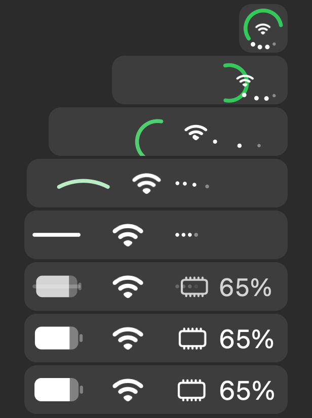

<p align="center">
  
</p>

<h1 align="center">Twofold</h1>

<p align="center">
  One live mark in the menu bar for battery, Wi-Fi and memory that unfolds into icons when you click it. Native, free, and open source.
</p>

<p align="center">
  
  <a href="LICENSE"></a>
</p>

<p align="center">
  <a href="docs/user/README.md">User guide</a>
  ·
  <a href="docs/feature-map.md">Feature map</a>
</p>

<br>

<p align="center">
  
</p>

The ring, the center and the four dots each carry a reading. Click the mark and it unfolds into one icon per reading; click an icon and its page opens in a popover with real controls: Wi-Fi power, volume and output, Bluetooth devices, Keep Awake, and live graphs for network and CPU.

Twofold makes no network calls, collects nothing, and costs the Mac it runs on almost nothing: one timer every two seconds and a mark drawn by hand.

## Twofold and DuoBar

Twofold is an open-source alternative to [DuoBar](https://www.teekamsuthar.com/duobar), and the idea, the mark, and the unfold come from there. If you want the polished original, use DuoBar and support its author.

## Install

Twofold is built from source. You need macOS 14 or later and the Xcode Command Line Tools (`xcode-select --install`).

```sh
git clone https://github.com/Moltenship/twofold.git
cd twofold
scripts/build-app.sh
cp -R dist/Twofold.app /Applications/
open /Applications/Twofold.app
```

The app is signed ad hoc, so it runs on the Mac that built it.

## Contributing

`swift build` compiles, `scripts/build-app.sh --run` builds and relaunches the app. See [AGENTS.md](AGENTS.md) for how the project is put together and [docs/operations](docs/operations/build.md) for the details.

## License

[MIT](LICENSE)
