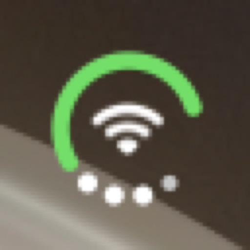
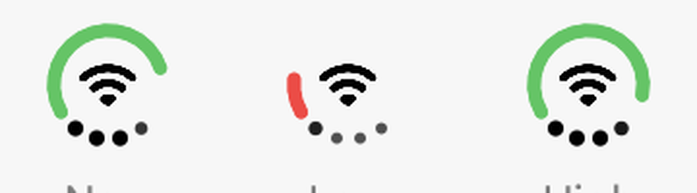
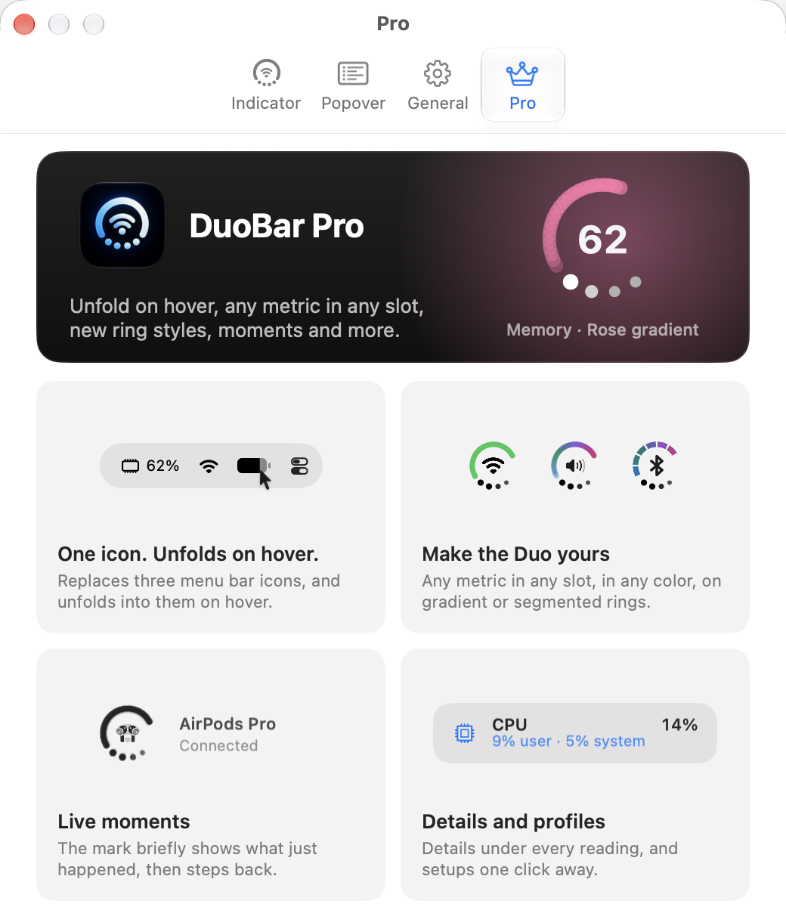

# Menu bar mark

One status item, 24 × 24 pt, describes itself to accessibility as "DuoBar. Battery 80%, Not Charging. Wi-Fi Connected, Excellent signal. Memory 82%, 39,54 GB of 48 GB."

- **Ring:** an arc with an open gap at the bottom. Measured on the menu bar mark: it starts at about 215° (bottom left, angles counter-clockwise from 3 o'clock) and a full ring sweeps about 256° clockwise over the top, ending at about −41°. The arc is filled from the start, so 80% ends near 10°. Round caps, 2.17 pt wide at Regular, centered on a circle of about 8.7 pt radius (9.8 pt to the outer edge).
- **Center:** a glyph (Wi-Fi by default) about 9 pt wide, heavier than the system's regular weight and centered on its ink. Percentage metrics show their number instead, set in a rounded bold face ("62", "87").
- **Dots:** four dots in the gap, on the same circle as the ring, at about 233°, 258°, 282° and 307°. Lit dots are about 2.6 pt across at full opacity; unlit ones are smaller and dim. 82% lights three; the Low preview lights one.
- Default slots: ring = Battery, center = Wi-Fi, dots = Memory.
- **Charging:** unverified. The binary has a `showsChargingBolt` flag, and a bolt at the end of the ring line has been seen while charging; it could not be captured on a Mac held at 80% ("not charging").
- Automatic color: battery ring green, red when low. Center and dots follow the menu bar's text color.

The Pro tab shows the mark large, cycling through metric and style combinations with a crossfade: "Memory · Rose gradient", "CPU · Rose segmented", "CPU · Aurora gradient", "Volume · Violet segmented", "Bluetooth · Sunset gradient". See [ring styles](../14-indicator-settings/ring-styles-loop.png).

