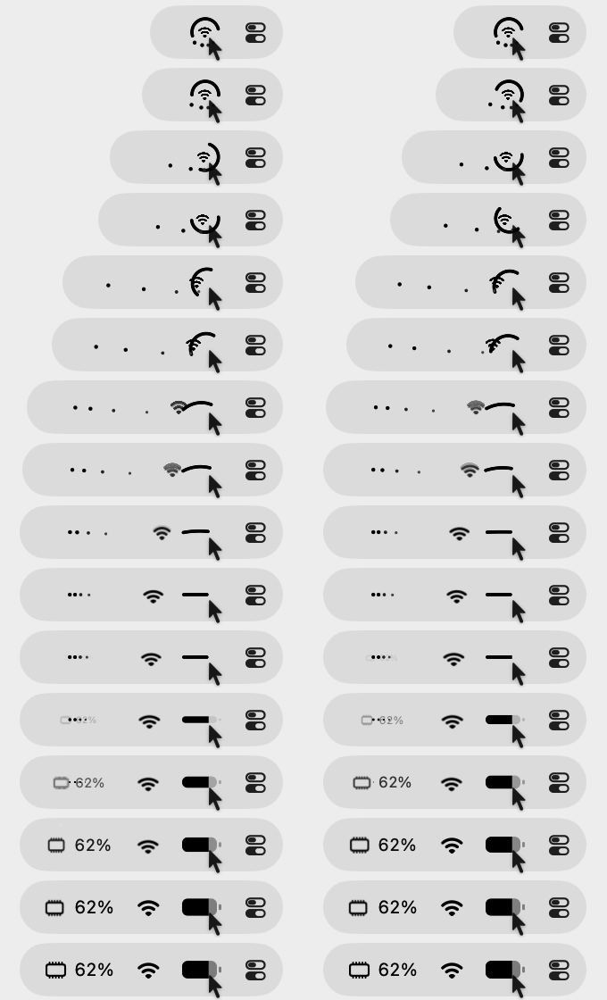
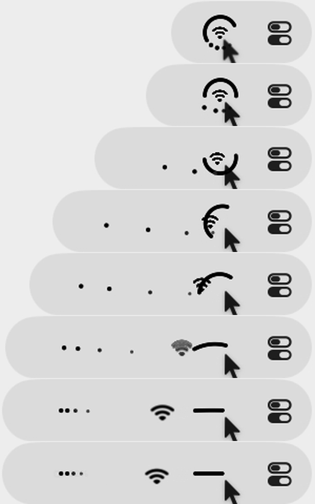
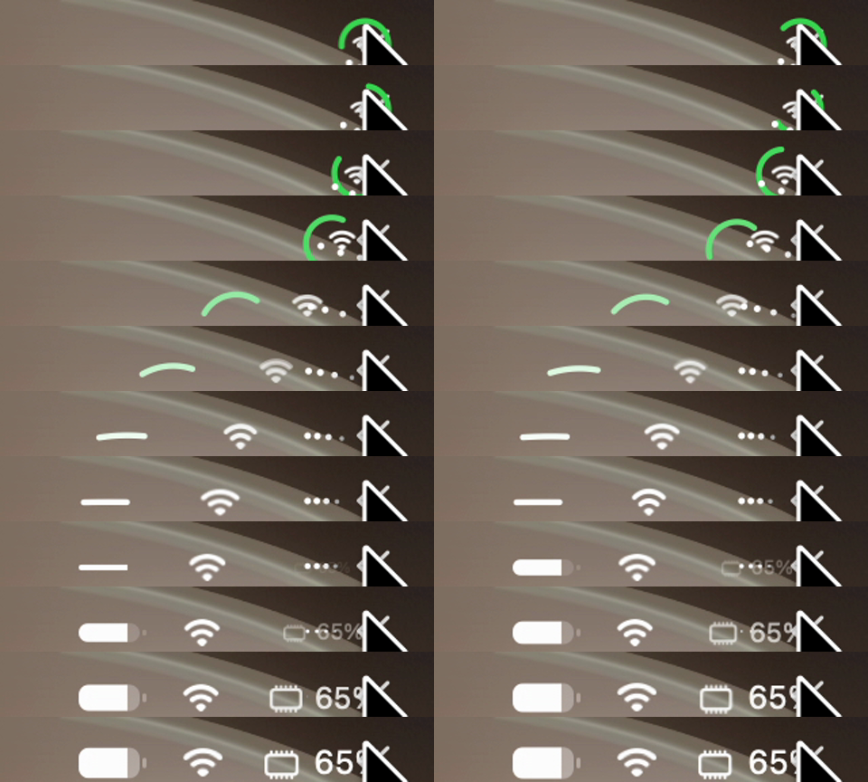
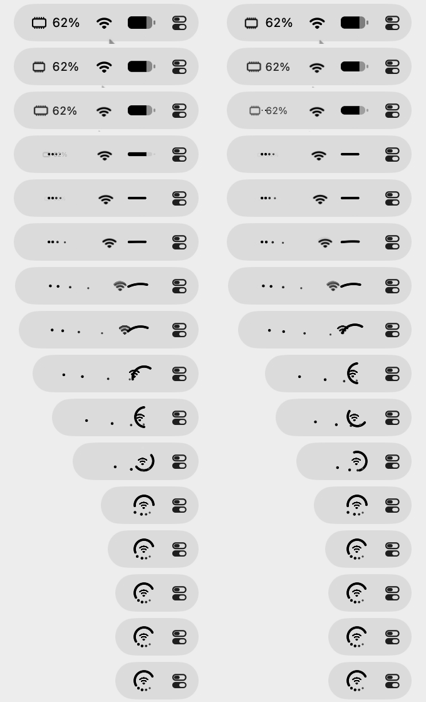

# Unfold

Settings → General → Hover → "When hovering over DuoBar icon": Do Nothing (default), Show Popover, Expand into Icons. Expand into Icons is Pro. With it, pointing at the mark widens the status item to the left and turns the mark into one icon per slot; clicking one opens its page; moving away folds them back.

## Unfold, frame by frame

Demo loop from the Pro tab, one frame per tile (60 fps):

Key frames, zoomed (every third frame):

The real menu bar, one frame per tile:

What moves, over about 22 frames (≈ 370 ms) plus a few frames of settle:

1. **Width.** The item grows to the left with an ease-out; its right edge stays put.
2. **Ring.** The arc spins and straightens at the same time, keeping its length: by a third of the way it is a half-circle, then a shallow bow, then a straight horizontal stroke. In the menu bar it travels to the far left slot; in color it fades from green to the menu bar's text color as it straightens. At about 60% the stroke thickens and crossfades into a battery glyph filled to the level, cap included.
3. **Center.** The Wi-Fi glyph grows from its small in-ring size to a full menu bar glyph and slides to the middle slot. It reads as a plain translation and scale; no crossfade.
4. **Dots.** The four dots leave the arc and line up horizontally while sliding to their slot, spreading out first, then bunching into a tight "••••" row, which crossfades into the memory chip glyph and "65%".
5. **Settle.** The new glyphs scale up the last few percent.

Slot order in the menu bar: ring's icon left, center in the middle, dots' icon right (nearest the original position). The demo card uses the mirrored order.

## Fold

The exact reverse, about 24 frames, ending with a small overshoot of the width. In the real menu bar, moving away also blurred the icons out before the mark returned.
