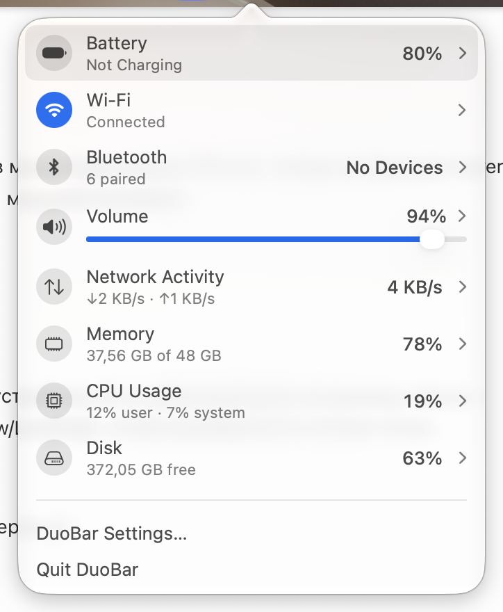
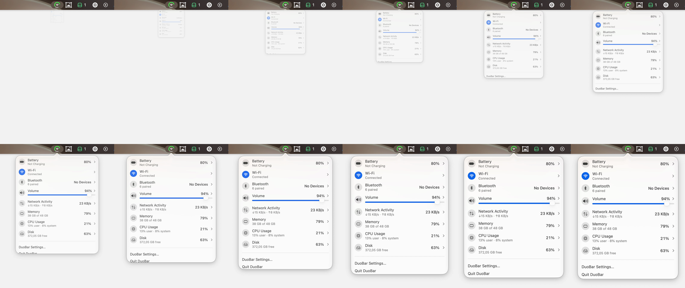
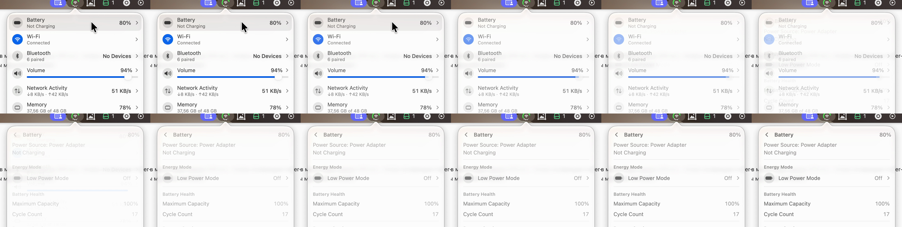

# Popover

Clicking the mark opens an `NSPopover` with an arrow, 362 pt wide. The status item shows the pressed (highlighted) capsule while it is open.

Rows, 40 pt tall: a 26 pt round icon well, title, a detail line ("Not Charging", "6 paired", "↓17 KB/s · ↑322 KB/s", "39,78 GB of 48 GB", "24% user · 8% system", "372,06 GB free"), a value on the right and a chevron. Wi-Fi's icon well is blue when connected and acts as the on/off switch. Volume has its slider under the title, full width, and its icon toggles mute. A separator, then "DuoBar Settings…" and "Quit DuoBar". Hovering a row draws a rounded gray highlight.

## Opening

The system popover animation: it grows from the arrow with a fade, about 10 frames.

## Pages

Clicking a row replaces the list with that module's page: a header with a back chevron, the module name, and its value. The old content fades out in about 3 frames, the new one fades in over about 5, and the popover resizes to the new height at the same time. Back reverses it. Every page ends with a link to the matching System Settings pane or app ("Battery Settings…", "Activity Monitor…").

