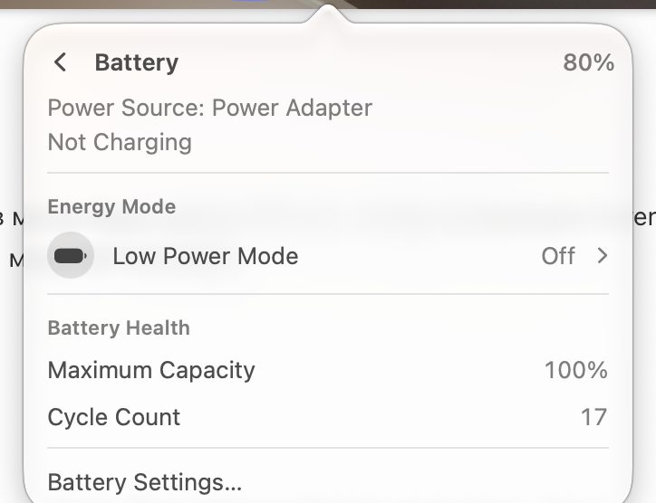

# Battery

Row: "Battery", detail "Not Charging" / "Charging" / time remaining, value "80%".

Page: "Power Source: Power Adapter" or "Battery", charging state; Energy Mode → Low Power Mode with Off/On (a row with a chevron); Battery Health → Maximum Capacity, Cycle Count; "Battery Settings…".

The website also lists time remaining.
