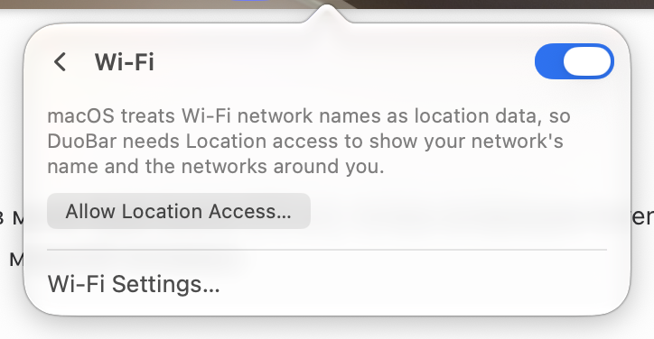

# Wi-Fi

Row: blue round Wi-Fi well when on (click toggles power), detail "Connected" or the network name.

Page: a switch in the header turns Wi-Fi on and off. Without Location access it says: "macOS treats Wi-Fi network names as location data, so DuoBar needs Location access to show your network's name and the networks around you." with "Allow Location Access…". With access it lists the networks around, and joining one in a click is behind Settings → General → Experimental. "Wi-Fi Settings…" at the bottom.

