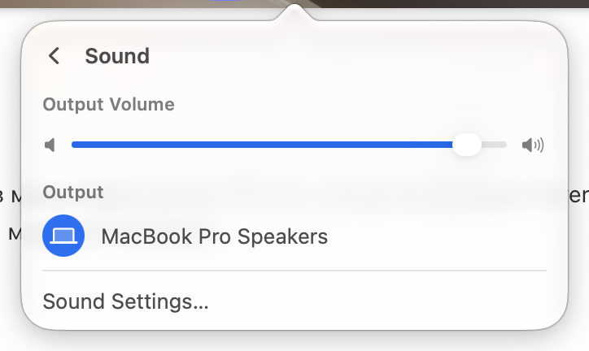

# Sound

Row: "Volume" with "94%", a full-width slider under the title, and the speaker icon as a mute toggle.

Page "Sound": Output Volume slider between a speaker and a loud speaker glyph; Output → one row per output device with a round blue icon for the current one; "Sound Settings…".

