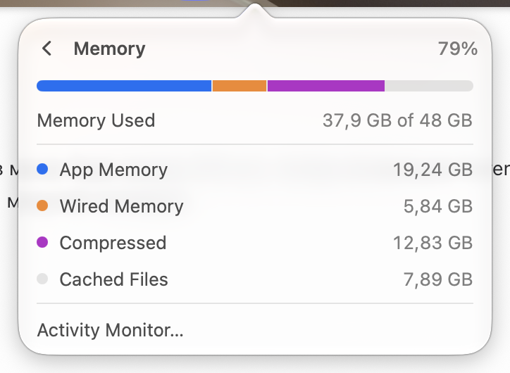

# Memory

Row: "Memory", detail "39,78 GB of 48 GB", value "83%".

Page: a stacked bar (App blue, Wired orange, Compressed purple, the rest gray), "Memory Used 33,64 GB of 48 GB", then App Memory, Wired Memory, Compressed, Cached Files with colored bullets, and "Activity Monitor…". The split matches Activity Monitor.

