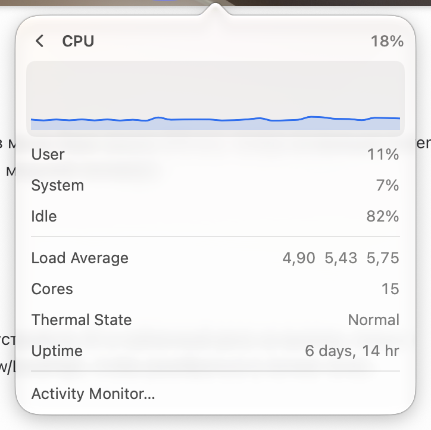

# CPU

Row: "CPU Usage", detail "24% user · 8% system", value "32%".

Page "CPU": a usage graph (blue line with a light fill) on a gray rounded card; User, System, Idle; Load Average (three numbers), Cores, Thermal State (Normal / Fair / Serious / Critical), Uptime ("6 days, 14 hr"); "Activity Monitor…".

