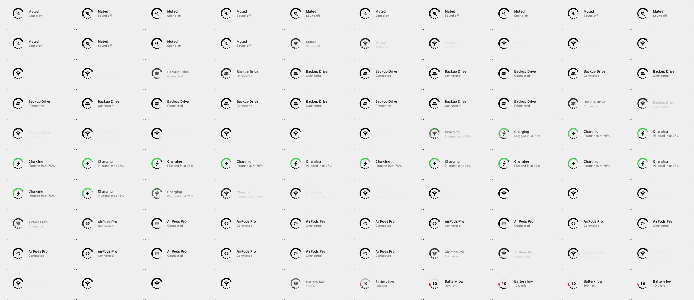
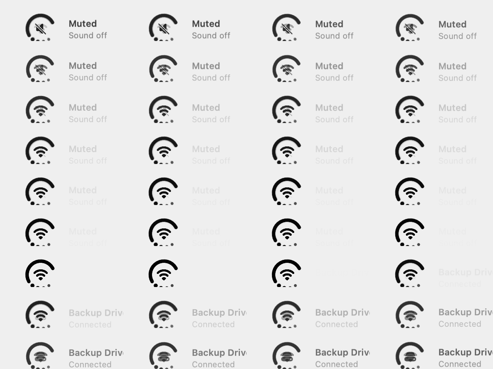

# Live moments

Settings → General → Moments → "Show moments: Briefly shows what just happened like plugging in, AirPods connecting etc." On by default (Pro).

For a couple of seconds the mark shows the event and a two-line label to its right, then steps back. Seen in the Pro demo loop:

| Event | Center glyph | Ring | Label |
|---|---|---|---|
| Mute | speaker with a slash | unchanged | Muted · Sound off |
| Drive mounted | external drive | unchanged | Backup Drive · Connected |
| Plugged in | bolt | green, at the level | Charging · Plugged in at 76% |
| AirPods connected | AirPods | unchanged | AirPods Pro · Connected |
| Battery low | the number "10" | short red arc | Battery low · 10% left |

Transition, one frame per tile: the center glyph crossfades in about 10 frames; the label fades out more slowly, about 20 frames, drifting down a point. The next label fades in the same way.

