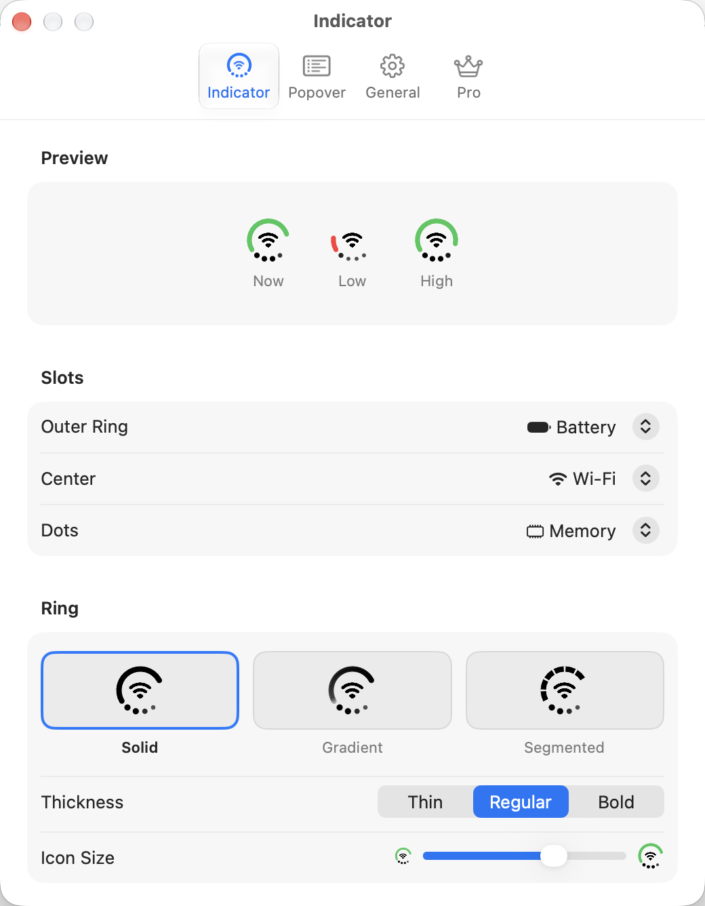
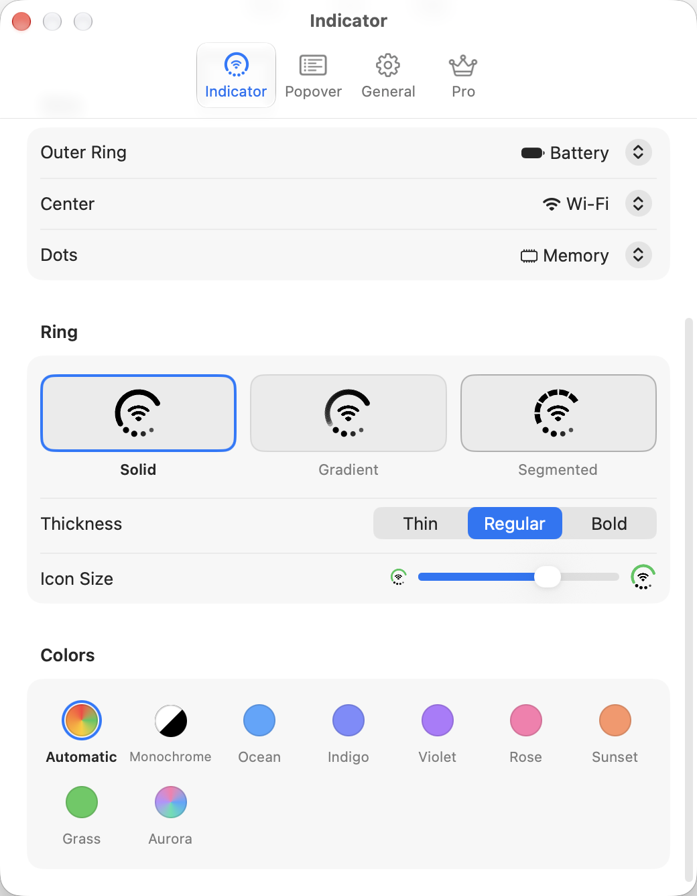
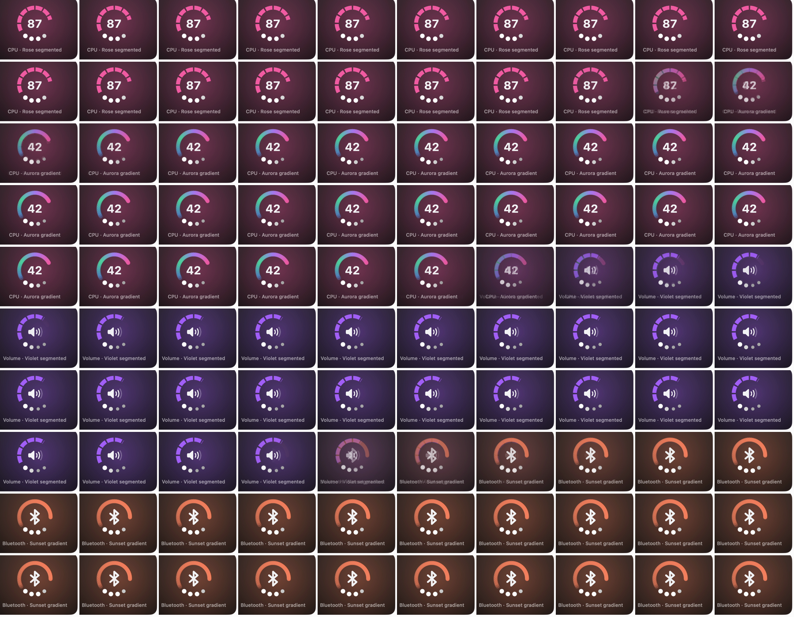

# Indicator settings

Settings → Indicator.

- **Preview:** three marks labeled Now, Low, High.
- **Slots:** Outer Ring, Center, Dots, each a pop-up of Battery, Wi-Fi, Bluetooth, Volume, Network, Memory, CPU, Disk with the module's glyph.
- **Ring:** style picked from drawings: Solid, Gradient (fades in along the arc), Segmented (dashes). Thickness: Thin, Regular, Bold. Icon Size: a slider between a small and a large mark.
- **Colors:** Automatic, Monochrome, Ocean, Indigo, Violet, Rose, Sunset, Grass, Aurora (a multicolor gradient).

