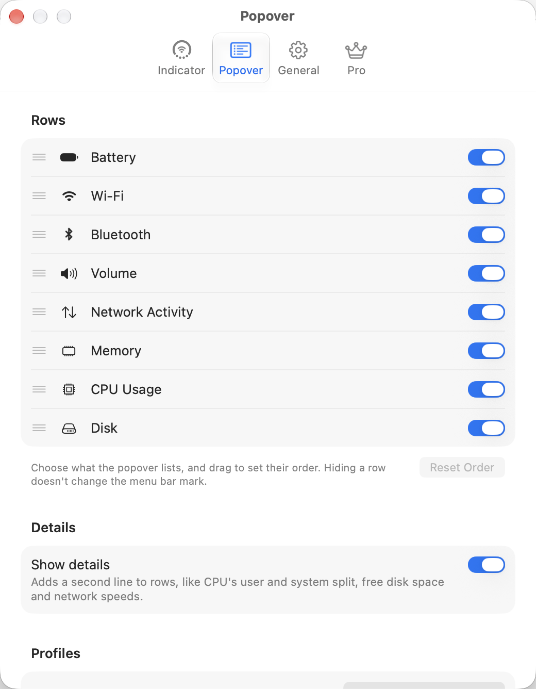
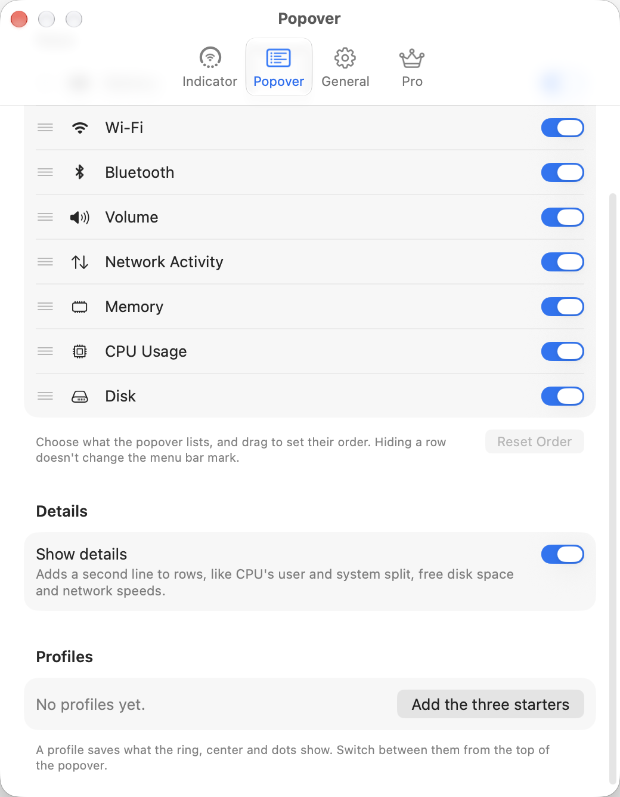

# Popover settings and profiles

Settings → Popover.

- **Rows:** one per module with a drag handle, glyph, name, and switch. "Choose what the popover lists, and drag to set their order. Hiding a row doesn't change the menu bar mark." with Reset Order.
- **Details:** "Show details: Adds a second line to rows, like CPU's user and system split, free disk space and network speeds."
- **Profiles:** "No profiles yet." with "Add the three starters". "A profile saves what the ring, center and dots show. Switch between them from the top of the popover." The website names the starters Work, Travel and Minimal ("Work: CPU on the ring, memory on the dots").
