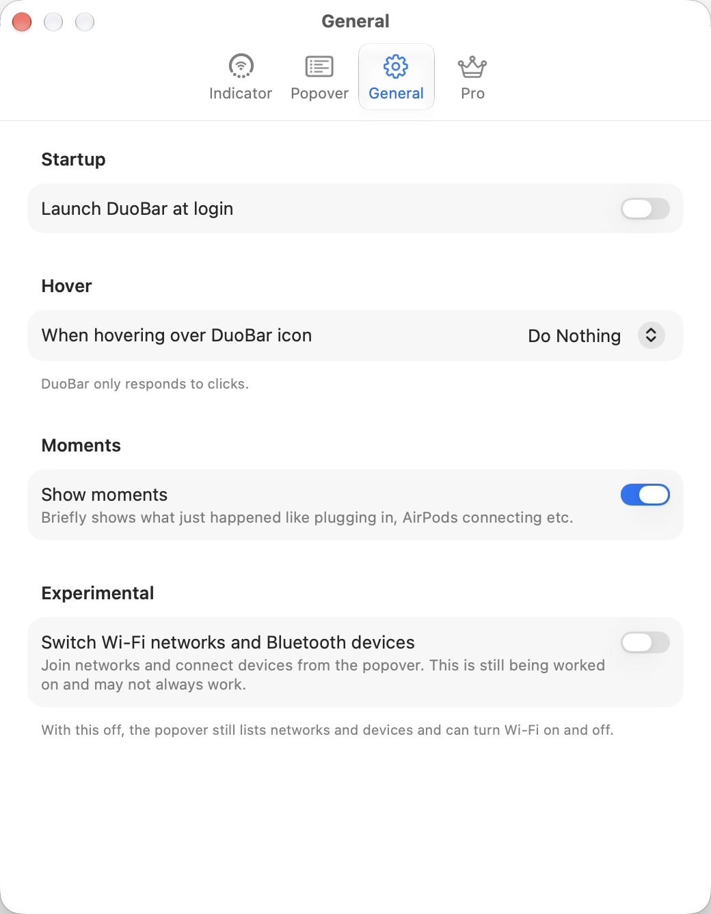

# General settings

- **Startup:** Launch DuoBar at login (off).
- **Hover:** When hovering over DuoBar icon: Do Nothing, Show Popover, Expand into Icons. With Do Nothing: "DuoBar only responds to clicks."
- **Moments:** Show moments (on).
- **Experimental:** "Switch Wi-Fi networks and Bluetooth devices: Join networks and connect devices from the popover. This is still being worked on and may not always work." Off. "With this off, the popover still lists networks and devices and can turn Wi-Fi on and off."
